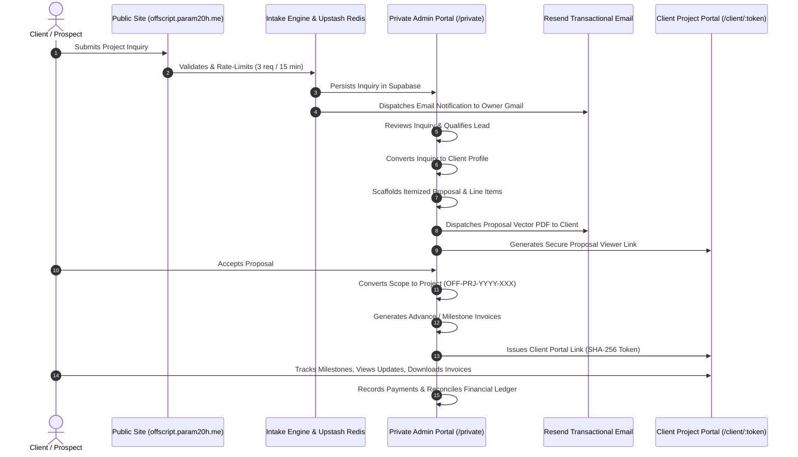

# OFFSCRIPT STUDIO — COMPLETE SYSTEM DOCUMENTATION
## Enterprise Architecture, Security Guarantees & Operations Manual

**Production Domain:** `https://offscript.param20h.me`  
**Official Business Email:** `offscript@param20h.me`  
**Owner Private Inbox:** `paramjit.offical34@gmail.com`  
**Transactional Sender:** `OFFSCRIPT Studio <inquiries@offscript.param20h.me>`  
**Tech Stack:** Next.js 16 App Router, React 19, TypeScript (Strict), Tailwind CSS v4, Supabase PostgreSQL, Upstash Redis, Resend, jsPDF.  

---

### 1. Executive Summary & Brand Identity

OFFSCRIPT Studio is an independent digital engineering agency offering custom SaaS, modern web applications, autonomous AI agents, vector RAG knowledge systems, and cloud infrastructure.

**Brand Tokens:**
- **Obsidian (`#171717`):** Dominant dark surface for studio operations and public marketing.
- **Warm Ivory (`#F0EDE5`):** Text contrast on dark surfaces; primary background for client-facing documents and the Client Project Portal.
- **Acid Lime (`#D6FF35`):** Selective architectural accents, delivery progress indicators, and primary call-to-action triggers.

---

### 2. End-to-End Operational Lifecycle

OFFSCRIPT Studio unifies the complete client relationship into a unified lifecycle:

---

### 3. Architecture & Routing Matrix

#### 3.1 Public Marketing & Agency Web (Warm Ivory & Obsidian)
- `/`: Editorial agency homepage with typographic hero, case studies, services, process, and inquiry form.
- `/work`: Filterable portfolio of verified digital engineering projects.
- `/work/[slug]`: In-depth case studies (e.g. ZenithFlow, Vesta AI, CampusIQ).
- `/services`: Digital engineering capabilities, AI agents, RAG, custom software.
- `/packages`: Scope-based transparent packages (Launch, Scale, Intelligence, Custom).
- `/about`: Studio engineering philosophy and methodology.
- `/contact`: Intake form, Calendly booking integration, official email.
- `/privacy` & `/terms`: Legal compliance documents.

#### 3.2 Private Agency Operations Portal (`/private`)
Protected by cryptographic session cookies and Scrypt hash authentication:
- `/private`: Operations overview with KPI summaries.
- `/private/inquiries`: Intake queue, business status tracking, and internal notes.
- `/private/clients`: CRM directory, client profiles, and portal token management.
- `/private/proposals`: Commercial proposal builder, pricing engine, and PDF issuance.
- `/private/invoices`: Tax invoice management, payment ledger, and PDF issuance.
- `/private/projects`: Engagement delivery tracker, milestones, tasks, and updates.
- `/private/analytics`: Business intelligence, sales funnel, and CSV data export.

#### 3.3 Client-Facing Document Portals
- `/proposal/[token]`: Read-only, client-facing proposal document viewer with vector PDF streaming.
- `/client/[token]`: Full Client Project Portal styled in Warm Ivory (`#F0EDE5`), featuring active projects, milestones, updates, proposals, and invoices.

---

### 4. Database Schema & Migration Catalog

The database consists of 8 migrations executed sequentially against Supabase PostgreSQL:

| Migration | Name | Description |
| :--- | :--- | :--- |
| **001** | `inquiries` | Initial inquiries table, RLS, indexes. |
| **002** | `inquiry_hardening` | Business status enum, internal notes, converted client relation. |
| **003** | `clients` | Client directory, client notes, client status, and type enums. |
| **004** | `proposals` | Proposals, line items, deliverables, milestones, activity history. |
| **005** | `invoices` | Invoices, invoice items, payment ledger, invoice activity. |
| **006** | `proposal_access_tokens` | SHA-256 client proposal access tokens. |
| **007** | `projects` | Projects, project milestones, tasks, updates, and delivery activity. |
| **008** | `client_portal_tokens` | SHA-256 client portal access tokens with 30-day lifecycle. |

---

### 5. Security & Production Hardening Catalog

1. **Zero Client-Side Secrets:**
   - Centralized server configuration module in [`src/lib/config.ts`](file:///Users/param/Startup/src/lib/config.ts) (`import "server-only"`).
   - Zero `NEXT_PUBLIC_` variables used in codebase.
2. **Distributed Rate Limiting (SEC-01 & SEC-02):**
   - Sliding-window rate limiter powered by Upstash Redis.
   - Public inquiries: Maximum 3 submissions per IP per 15 minutes.
   - Admin login: Maximum 5 failed attempts per IP per 15 minutes with exponential lockout.
3. **Strict Origin & CSRF Defense (SEC-04):**
   - Implemented in [`src/lib/security.ts`](file:///Users/param/Startup/src/lib/security.ts).
   - Enforced on all mutating HTTP methods (`POST`, `PATCH`, `DELETE`).
4. **CSV Formula Injection Mitigation (CVE-2014-3524):**
   - Implemented in [`src/lib/analytics/engine.ts`](file:///Users/param/Startup/src/lib/analytics/engine.ts).
   - Sanitizes all exported fields starting with `=+\-@\t\r` by prepending a single quote.
5. **Observability & Structured Logging:**
   - Implemented in [`src/lib/logger.ts`](file:///Users/param/Startup/src/lib/logger.ts).
   - Outputs JSON log entries with UUID v4 correlation IDs.
   - Automatically redacts passwords, tokens, API keys, and session secrets.

---

### 6. Operations & Maintenance Runbook

#### 6.1 Creating a New Project from an Accepted Proposal
1. Navigate to `/private/proposals/[id]`.
2. Click **"Convert to Project"** in the action bar.
3. The system pre-populates project title, overview, budget, currency, and converts proposal deliverables/milestones directly into project delivery milestones.
4. Review target completion dates and click **"Create Project Dossier"**.
5. The system assigns a sequential project number (`OFF-PRJ-YYYY-XXX`) and redirects to the Project Dossier.

#### 6.2 Issuing a Client Portal Access Link
1. Navigate to `/private/clients/[id]`.
2. Scroll to the **"Client Project Portal Link"** section.
3. Click **"Generate Portal Link"**.
4. Click **"Copy"** and email the link to the client representative.
5. The link gives the client read-only access to their deliverables, milestones, proposals, and invoices for 30 days.

#### 6.3 Exporting Financial Data for Bookkeeping
1. Navigate to `/private/analytics`.
2. Scroll to the **"Secure Data Export Center"**.
3. Click **"Invoices CSV"** or **"Projects CSV"** to download the sanitized report.
